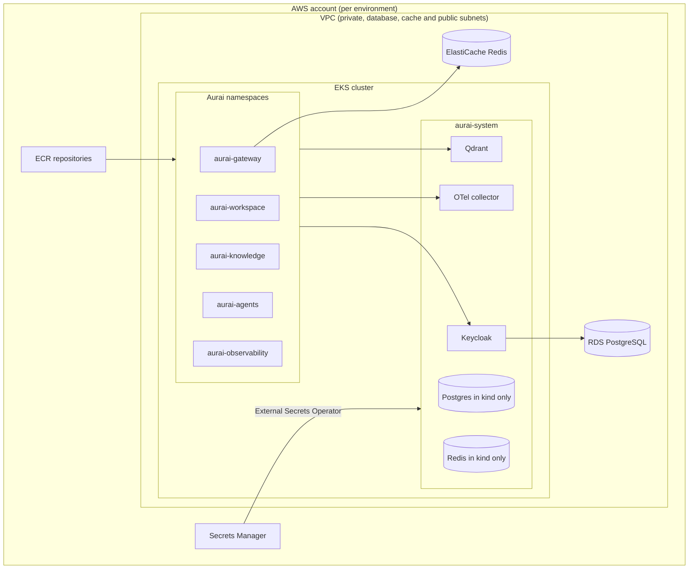

# Architecture

## Scope
`aurai-infra` owns the cluster and the services that many Aurai components share. It does not deploy the gateway, workspace, agents, connectors or knowledge pipelines; those repositories bring their own charts and install into the namespaces created here.

## Topology

In `kind`, Postgres and Redis run inside the cluster. In AWS they are RDS and ElastiCache, and the chart disables the in-cluster copies.

## Namespaces
| Namespace | Owner | Purpose |
|---|---|---|
| `aurai-system` | this repo | Shared services |
| `aurai-gateway` | `aurai-gateway` | LiteLLM |
| `aurai-workspace` | `aurai-workspace` | Open WebUI |
| `aurai-knowledge` | `aurai-knowledge-rag` | Ingestion and retrieval services |
| `aurai-agents` | `aurai-agent-runtime`, `aurai-mcp-connectors` | Agents, workflows, connectors |
| `aurai-observability` | `aurai-eval-governance` | Langfuse, Phoenix, evaluation jobs |

The application namespaces carry `aurai.io/platform-access=true`, which the network policies use to allow access to shared services.

## Network model
- Default deny ingress inside `aurai-system`.
- Allowed: same-namespace traffic, namespaces labelled `aurai.io/platform-access=true`, and (in AWS) the VPC CIDR to Keycloak so an ALB with IP targets can reach it.
- kind's default network plugin does not enforce NetworkPolicy. Use Calico or Cilium locally to test enforcement; EKS needs network policy support enabled in the VPC CNI or a policy engine.

## Data stores
| Service | Local | AWS |
|---|---|---|
| PostgreSQL | StatefulSet (postgres:16.4) | RDS with generated master password in Secrets Manager, TLS enforced, encrypted storage |
| Redis | StatefulSet (redis 7.4) | ElastiCache replication group with in-transit and at-rest encryption |
| Qdrant | StatefulSet | StatefulSet on gp3 volumes (EBS CSI driver) |

## Tracing pipeline
All services send OTLP to `otel-collector.aurai-system:4317` (gRPC) or `:4318` (HTTP). The collector runs memory limiting and batching, and exports to a debug sink by default. `aurai-eval-governance` adds the Langfuse and Phoenix exporters.

## Terraform structure
`modules/platform` wraps the community VPC, EKS, RDS and IAM modules and adds ElastiCache, Secrets Manager containers and ECR. Each environment folder sets sizing and calls the module once, so a change to the shape of the platform happens in one place.

## Design decisions
- **One chart for shared services.** Keeps platform concerns together; each application repo owns its own release.
- **Managed data stores in AWS.** Backups, patching and failover belong to the cloud provider.
- **External Secrets over stored secrets.** Secret values live in Secrets Manager and never in Git, Helm values or Terraform state.
- **No cluster-wide ingress controller in kind.** Local access uses port-forwarding. AWS uses the AWS Load Balancer Controller through ingress class `alb`.
